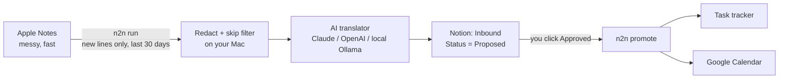

# notes-to-notion

I turned my notes app into the interface between my messy thoughts and my organized Notion, with an AI agent as the translator.

> **Status:** v0.1, early. Built from the pipeline I run every day; the open-source version is tested on sample notes. Issues and PRs welcome.

When my boss is mid-sentence, I'm not opening Notion and picking a database. I'm typing `pset 4 due thurs!!` into Apple Notes with my thumbs. This tool reads what I wrote, cleans it up, figures out what it is (task, event, contact, idea), and files it into a Notion review queue. I approve it with one click and it lands in my real task tracker and calendar.

```
pset 4 due thurs!!                    →  Problem Set 4          Task   · School · High · due Thu
email maya abt the lease renewal      →  Email Maya about the lease renewal
new vendor contact - Sam Lee ...      →  Sam Lee (vendor)       Contact
wifi password: correct-horse-...      →  (never leaves your Mac)
```

## How it works



1. **Capture anywhere.** Write in Apple Notes like you always do. Keep appending to the same "to do" note; only new lines get picked up.
2. **Translate.** `n2n run` grabs notes changed since the last run, strips secrets and anything you told it to skip, and sends the rest to the model you chose. It comes back as clean, typed items.
3. **Review.** Items land in an **Inbound** database in Notion as `Proposed`. Nothing touches your real tracker until you flip a row to `Approved`.
4. **File.** `n2n promote` copies approved rows into your existing task database (and optionally Google Calendar), then marks them `Filed`.

## Privacy and safety

This touches the most personal app on your phone, so it's built around a few hard rules:

- **Read-only.** It never edits or deletes anything in Apple Notes.
- **30-day window, hard limit.** Only notes modified in the last 30 days are read, and the date filter runs inside Notes.app, so older notes never leave it. The config refuses anything above 30.
- **Secrets are stripped on your Mac** before any network call: password/PIN/login lines, API-key-shaped strings, card numbers.
- **Skip keywords never leave your Mac.** Lines containing them (say, your day job) are dropped before the AI sees anything.
- **Prompt-injection aware.** Notes are treated as untrusted data. The translator is told never to follow instructions inside a note, and every field it returns is validated against your config before it's written.
- **Human in the loop.** Ingest only ever writes `Proposed`. You decide what gets filed.
- **No raw text in local state.** It remembers what it has seen using SHA-256 fingerprints, not your words.
- **Your choice of model.** With a cloud provider, the (redacted, filtered) note text goes to that provider. Want zero cloud? Use Ollama and everything stays on your machine.

Redaction is a safety net, not a vault. Keep real passwords in a password manager.

## Setup

Requires macOS (for Apple Notes), Python 3.11+, a Notion integration, and an AI provider.

```bash
pip install git+https://github.com/ka1saucedo/notes-to-notion
n2n init                     # writes ~/.config/notes-to-notion/config.toml
```

1. **Notion:** create an internal integration at notion.so/my-integrations, then share a page with it (page menu → Connect to). Export the token:
   ```bash
   export NOTION_API_KEY=ntn_...
   ```
2. **AI:** pick a provider in the config and set `ai.model` to a current model id.
   ```bash
   export ANTHROPIC_API_KEY=...      # provider = "anthropic"
   # or OPENAI_API_KEY for "openai"; nothing for "ollama"
   ```
3. **Make it yours:** edit `categories`, `task_types`, `timezone`, `skip_keywords`, and `expansions` (your shorthand) in the config.
4. **Create the review database:**
   ```bash
   n2n setup-notion --parent-page <page id>
   ```
5. **Start fresh:** mark existing notes as seen so only what you write from now on gets captured.
   ```bash
   n2n baseline
   ```
6. **Check everything:** `n2n doctor`

Try it without touching your notes or Notion:

```bash
n2n run --from-file examples/sample_notes.json --dry-run
```

## Usage

```bash
n2n run              # new notes → Inbound (Proposed)
n2n run --dry-run    # translate and print, write nothing
n2n promote          # Approved rows → tracker + calendar
n2n promote --dry-run
```

Run it on a schedule with cron or launchd (every 30 minutes for `run`, hourly for `promote`). Notes.app needs the Mac awake; a missed tick just runs next time.

**Filing into your existing tracker:** set `notion.tracker_data_source_id` and map your column names under `[tracker]`. Leave it empty and approved rows are simply marked `Filed`.

**Google Calendar:** `pip install "notes-to-notion[calendar]"`, set `calendar.provider = "google"` and `google_token_file` to an authorized-user OAuth token with the calendar.events scope. Events with a time become a block; date-only events become all-day.

## Use it with an agent (Hermes)

The CLI also works as the hands for an AI agent that does the translating itself:

```bash
n2n dump > notes.json        # redacted, skip-filtered new lines
# agent writes items.json
n2n add --file items.json    # validated, filed as Proposed
n2n commit                   # mark those notes as captured
```

A ready-made [Hermes](https://hermes-agent.nousresearch.com) skill lives in [`hermes/SKILL.md`](hermes/SKILL.md).

## Development

```bash
PYTHONPATH=src python3 -m unittest discover -s tests
```

Tests run on fake notes only. No real note text belongs in this repo, ever.

## License

MIT
